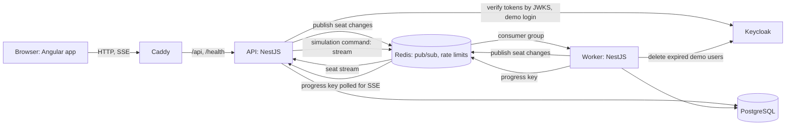

# ticketmaster-klon

> Unofficial demo. Not affiliated with Ticketmaster.

A ticket booking system for events with seats. Many buyers compete for the same seats at the same
time, no seat is sold twice, and the seat map updates live for everyone watching.

The target system, its requirements and the phases are described in [docs/PLAN.md](docs/PLAN.md);
the current state is in [docs/BACKLOG.md](docs/BACKLOG.md).

## Quickstart

Requirements: Node 26, pnpm 12 and Docker.

```sh
pnpm install
docker compose up --build   # the whole stack; open http://localhost:8080
```

For development with reload: `pnpm dev` (API on port 3000, web on port 4200).

The start page has no registration: one click logs in as a **customer**, an **organizer** or an
**admin**. The demo login creates a temporary user in Keycloak with that role; the user expires
after an hour by default and is then deleted. Each demo user gets four private sandbox events of
their own.

| Role      | Can do                                                                                                           |
| --------- | ---------------------------------------------------------------------------------------------------------------- |
| customer  | hold a seat, pay, cancel, list their own bookings                                                                |
| organizer | list venues, create events, see sales and utilization of their own events                                        |
| admin     | switch the booking strategy of an event (a demo admin: of their own sandbox events only), run the rush simulator |

Anyone, signed in or not, can browse public events and watch the seat map.

## Requirements

- Browse public events and see the seat map of an event with the live status of every seat
  (available, held, sold); changes by other buyers appear within about a second.
- Hold a seat for a short time, pay for it with a simulated payment, cancel it. A seat is never
  sold twice, whichever of the four booking strategies the event uses.
- Roles with checks on the server: customers book, organizers create events and see their sales,
  admins switch the strategy of an event. A user sees and changes only their own bookings.
- A rush simulator for admins: virtual buyers race for the seats of a fresh sandbox event under one
  booking strategy, with live counters (holds, conflicts, retries, latency) and a comparison of the
  finished runs. Only `naive` shows double bookings.
- Keyboard operation, visible focus and a seat status that does not rely on color alone.

## Architecture

Preliminary. Caddy serves the web app and forwards `/api` and `/health` to the API; the API
verifies Keycloak tokens, writes to PostgreSQL and publishes every seat change to Redis, which fans
it out to the open seat streams. The worker runs the scheduled jobs (hold expiry, cleanup of demo
users) and the simulator: the API puts a run on a Redis stream, the worker's consumer runs the
buyers, and the API streams the progress from a Redis key to the admin's browser.



## Entities

Venues, events, seats, bookings, their transitions, the temporary demo users and the simulation runs. The tables and
relations are in [docs/data-model.md](docs/data-model.md).

## API

REST routes under `/api`; contracts are Zod schemas in `packages/shared`. The full description
(answers, errors, limits) is in [docs/api/rest.md](docs/api/rest.md).

| Route                              | Role      | Purpose                                                   |
| ---------------------------------- | --------- | --------------------------------------------------------- |
| `GET /api/events`                  | public    | public events (and the caller's own sandbox events)       |
| `GET /api/events/:id`              | public    | event with every seat and its status                      |
| `GET /api/events/:id/seats/stream` | public    | server-sent events: snapshot, then one change a seat      |
| `POST /api/demo-login`             | public    | temporary user and tokens for a role                      |
| `POST /api/auth/refresh`           | public    | new tokens for a refresh token                            |
| `POST /api/bookings`               | customer  | hold a seat                                               |
| `POST /api/bookings/:id/payment`   | customer  | pay (header `Idempotency-Key`)                            |
| `POST /api/bookings/:id/cancel`    | customer  | cancel a held or confirmed booking                        |
| `GET /api/bookings`                | customer  | the caller's bookings with their transitions              |
| `GET /api/venues`                  | organizer | venue templates                                           |
| `POST /api/events`                 | organizer | create an event from a venue template                     |
| `GET /api/organizer/events`        | organizer | own events with sold and held counts                      |
| `PATCH /api/events/:id/strategy`   | admin     | switch the booking strategy                               |
| `POST /api/simulations`            | admin     | start a simulator run (answers 429 above two active runs) |
| `GET /api/simulations`             | admin     | the finished runs of the last hour with their metrics     |
| `GET /api/simulations/:id`         | public    | one run with its status and metrics                       |
| `GET /api/simulations/:id/stream`  | public    | server-sent events: the live progress of a run            |

## Checks

- `pnpm check`: typecheck, lint, architecture rules, dead code, duplication, audits, formatting.
- `pnpm test`: unit tests, offline.
- `pnpm test:db`: tests that need Postgres and Redis (`pnpm db:up` and `pnpm db:migrate` first).
- `pnpm e2e`: browser tests against the whole Compose stack (builds it, runs it, removes it).

## Documentation

- [docs/PLAN.md](docs/PLAN.md): goal, requirements, stack, architecture overview, phases.
- [docs/adr/](docs/adr/): architecture decisions.
- [CONTRIBUTING.md](CONTRIBUTING.md): local setup, commands, tests, commits.
- [AGENTS.md](AGENTS.md): layers, invariants and workflow rules, enforced by tools.
- [SECURITY.md](SECURITY.md): how to report a vulnerability.

## License

[MIT](LICENSE)
