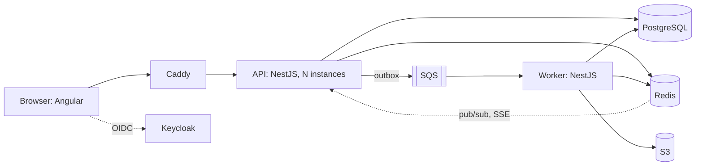

# Plan

Context, not status. What is open is in [BACKLOG.md](BACKLOG.md); git shows the rest. The rules for
working in this repo are in [AGENTS.md](../AGENTS.md).

## Goal

A ticket booking system for events with seats. The hard parts it solves:

- Many buyers compete for the same seats at the same time, and no seat is ever sold twice.
- Seat maps update live for everyone who is watching.
- The architecture scales horizontally and explains its trade-offs.
- Production readiness is part of the design from the start: authentication, security,
  scalability, observability and traceability.

Someone who opens the live demo understands within minutes what is hard about the problem and how
it is solved, and can try the app without any hurdle.

## Domain

**Roles**

- `customer`: browse events, reserve seats, pay, see and cancel own bookings.
- `organizer`: create events from venue templates, see sales status and utilization.
- `admin`: strategy switch, simulator, audit log, system status.

**Functional requirements**

- Browse events with venue and seat map.
- Reserve a seat (a hold with a TTL, for example 10 minutes), pay (fake payment with an idempotency
  key), booking confirmed, ticket as PDF.
- A hold expires or the payment fails: the seat becomes free again automatically.
- The seat map updates live for all viewers.
- Virtual waiting room for events in high demand: users join a Redis queue and are admitted to the
  booking area in controlled batches; their position is visible live.

**Non-functional requirements** (the README states them with numbers)

- No double booking, ever: consistency before availability when booking.
- Reading event pages: high load, availability before consistency, cached.
- Live updates arrive in under one second.
- Horizontal scaling: no in-memory state in the API process. Locks, rate limits, sessions and
  pub/sub run through Redis. Proof: Docker Compose starts at least two API instances behind Caddy
  as load balancer, and live updates work across instances.
- Service level objectives (availability, p95 latency of a reservation) with dashboards and alerts.

## Core feature: booking strategies under load

- **Strategy switch** per demo event: `naive` | `pessimistic` (`SELECT … FOR UPDATE`) |
  `optimistic` (version column) | `redis-lock` (hold with TTL). `naive` must be able to produce
  measurable double bookings; every other strategy produces zero. An ADR records that production
  additionally needs a database constraint as defense in depth and that `naive` exists only for
  comparison.
- **"Simulate a rush" button:** the worker starts N virtual buyers (default 500) against M seats
  (default 100). A live dashboard next to it shows bookings, conflicts and retries, double
  bookings, p50/p95 latency and a link to the matching trace in Grafana.
- **Real time:** Server-Sent Events, fanned out through Redis pub/sub. Test: two tabs, a reservation
  in tab A marks the seat as taken in tab B at once.

## Authentication and trying it out

Authentication must not get in the way of trying the app.

- **One-click demo login per role** on the start page. It creates a temporary user with an expiry
  (Keycloak Admin API) and signs in directly. A scheduled job cleans up.
- Regular registration and login through Keycloak (email and password; GitHub as identity provider
  is optional).
- Authorization through RBAC (roles from the token) and resource ownership, enforced on the server
  with guards and tested.
- Every demo user gets demo events of their own, so visitors do not disturb each other.
- Seed data with realistic events; fake payment with an adjustable failure rate.

## Security

- Threat model (STRIDE), oriented on OWASP ASVS level 1 to 2.
- Helmet and security headers, strict CORS, CSP in the frontend.
- Validate input at every boundary (Zod); typed output.
- Rate limiting per user and per IP (Redis), stricter limits for login and the simulator.
- Secrets only through environment variables.
- Containers: non-root user, minimal images, read-only file system where possible, resource limits.
- A security policy with a reporting channel.

## Observability and traceability

- **Tracing end to end:** browser, API, Postgres and Redis, outbox, SQS, worker. The trace context
  travels through the queue in message attributes.
- **Structured logs** (JSON, pino) with trace ID, request ID and user ID.
- **Metrics:** RED metrics per endpoint; business metrics (holds, bookings, conflicts, waiting room
  length, expired holds).
- **Grafana dashboards** provisioned as code; alerts for SLO violations.
- **Audit log:** who booked, cancelled, created events or switched the strategy, and when
  (append-only table).
- **Booking history:** state machine (held, paid, confirmed / expired / cancelled) with stored
  transitions.
- Health checks (`/health/live`, `/health/ready` with business signals such as stuck outbox
  entries) and graceful shutdown.
- Optional: the Grafana dashboard read-only in the live demo.

## Stack

| Area          | Choice                                                                  | Reason                                                               |
| ------------- | ----------------------------------------------------------------------- | -------------------------------------------------------------------- |
| Monorepo      | pnpm workspaces: web, api, worker, shared                               | One repo, contracts shared as a package                              |
| Contracts     | Zod schemas, inferred types, `as const` dictionaries                    | One source for validation and types on both sides                    |
| Frontend      | Angular (standalone components, signals, RxJS for streams), Tailwind    | Signals for state, RxJS for the SSE streams                          |
| Backend       | NestJS (modules, guards, pipes, interceptors, OpenAPI)                  | Module system matches the modular monolith                           |
| Persistence   | PostgreSQL behind PgBouncer, Drizzle ORM with generated migrations      | Transactions and row locks are the core of the booking strategies    |
| Cache, locks  | Redis                                                                   | Locks, rate limits, pub/sub and the waiting room outside the process |
| Auth          | Keycloak (OIDC, authorization code flow with PKCE), JWT checked by JWKS | Standard protocol, roles in the token                                |
| Cloud, local  | Floci (SQS, SNS, S3), infrastructure as code                            | Queue and object store without a paid service                        |
| Observability | OpenTelemetry, Prometheus, Tempo, Loki, Grafana, pino                   | Traces, metrics and logs with one correlation ID                     |
| Tests         | Vitest, Playwright, k6, StrykerJS                                       | Unit, browser, load and mutation tests                               |
| Edge          | Caddy                                                                   | Static files, load balancing, HTTPS                                  |

Deliberately excluded: Kubernetes, microservices, Java/Spring, AI features, paid services. The
architecture is a modular monolith plus a worker, and the API runs in several instances
([ADR 0001](adr/0001-modular-monolith-and-worker.md)).

## Architecture overview

## Quality and CI

- Unit tests (Vitest) and integration tests against a real Postgres and Redis.
- The concurrency test is mandatory: parallel bookings of the same seat, per strategy, asserting
  double bookings.
- Auth tests: every protected route with a wrong role and a foreign resource answers 403.
- Playwright: demo login, reserve, pay, confirmation; live update in a second tab.
- Mutation tests (StrykerJS) on the domain: weekly and on demand, not in a commit hook.
- GitHub Actions: quality (`pnpm check`, docs map over the commit range, dependency audit), unit
  tests, database tests, end-to-end tests, build, Trivy with an SBOM, Semgrep, gitleaks. Actions
  pinned to commit SHAs, read-only permissions.
- Dependabot for npm (minor and patch grouped), GitHub Actions, Docker and Docker Compose.

## Operations

- `docker compose up` starts everything locally; `pnpm db:up` starts only the infrastructure for
  tests.
- Public live demo: a Hetzner server with Docker Compose and Caddy (HTTPS). A deploy workflow
  deploys by SSH when CI on `main` is green. The README links the demo at the top.
- Deploy scripts: `provision.sh` (set up a fresh server from the developer machine, create the
  deploy key, set the GitHub secrets with `gh`, print no secret, safe to run again), `bootstrap.sh`,
  `backup.sh` (daily dump to S3 with rotation), `restore-check.sh` (load the dump into a throwaway
  Postgres and count tables).
- A dump before every deploy; the restore procedure is documented and tested; RPO and RTO are in
  the README.
- Uptime workflow: a GitHub Action calls the health endpoint every 15 minutes including the
  business signals; a red run is the alarm.
- Protection in public operation: the simulator is limited globally (one or two concurrent runs, a
  queue with a visible position, a cap on buyers per run) and every container has resource limits.
  A single visitor must not be able to stall the demo for others.
- Releases with SemVer tags and a changelog.
- Keycloak and the Grafana stack need memory: an ADR records the server size and the memory budget
  per container.

## Phases

Each phase ends with a stop and a short report. The Definition of Done of a phase is the list of
checks below it.

### Phase 0: Foundation

Monorepo, agent rules, plan and backlog, agent hooks and settings, Husky, `pnpm check` with all
audits, dependency-cruiser rules, CI skeleton, Docker Compose for Postgres, Redis and Keycloak,
empty Angular and NestJS apps with a health check, product name.

Definition of Done:

- `pnpm check`, `pnpm test` and CI are green; the hooks demonstrably work (hook tests green,
  `--no-verify` is blocked).
- dependency-cruiser fails on a forbidden import (checked once by hand).
- `docker compose up` starts the infrastructure and both apps with a health check.

### Phase 1: Core

Data model with the state machine, reservation flow with all four strategies, hold expiry, SSE,
simulator with live dashboard, Keycloak with one-click demo login and RBAC, basic security (headers,
CORS, validation, rate limits), structured logs with request ID.

Definition of Done:

- One-click demo login works for all three roles; role permissions are tested on the server.
- The simulator shows double bookings above zero in `naive` mode and zero for every other strategy
  (also as an automated test).
- The live update between two tabs works.
- CI is green.
- The README has requirements, entities, API and a preliminary architecture diagram.

### Phase 2: Async and scaling

Transactional outbox, SQS (Floci), worker: confirmation email (Mailpit or similar), ticket PDF to
S3, idempotent consumers, dead-letter queue. Virtual waiting room. Several API instances behind
Caddy. PgBouncer. Infrastructure as code.

### Phase 3: Observability and measuring

OpenTelemetry end to end including the queue, Grafana stack with provisioned dashboards, SLOs and
alerts, audit log view. k6 load tests (scenarios and results in a load test document), cache for
event pages with a measured effect.

### Phase 4: Hardening and polish

Threat model, container hardening, row-level security, mutation tests, security policy, changelog,
first release. Final README, architecture diagrams (Mermaid, dependency graph from
`pnpm depcruise:graph`), demo GIF at the top. Optional: bilingual UI (German and English).

### Phase 5: Live demo

Everything that needs a public server comes last (see [Operations](#operations)): server and
domain, the deploy scripts, the deploy workflow, backups with a tested restore, the uptime workflow,
the ADR for the server size and the memory budget, the runbooks, the demo link at the top of the
README.

Definition of Done:

- The live demo is publicly reachable over HTTPS and a green `main` deploys by itself.
- The uptime workflow is active.
- `restore-check.sh` loads a real backup.

## Documentation

Docs as code: a document changes in the same commit as the code it describes (enforced by the
docs-map audit). Nothing is maintained twice; link instead.

| Path                            | Content                                                                                                                                                                                                                                                                        |
| ------------------------------- | ------------------------------------------------------------------------------------------------------------------------------------------------------------------------------------------------------------------------------------------------------------------------------ |
| `README.md`                     | Entry: live demo, what the system solves, quickstart, diagram, key numbers, where it breaks first, the development process with coding agents                                                                                                                                  |
| `AGENTS.md`, `CLAUDE.md`        | Agent rules; the second only imports the first                                                                                                                                                                                                                                 |
| `PRODUCT.md`, `DESIGN.md`       | Product, roles and purpose; design tokens and UI principles                                                                                                                                                                                                                    |
| `CONTRIBUTING.md`               | Local setup, commands, test strategy, commit convention                                                                                                                                                                                                                        |
| `CHANGELOG.md`, `SECURITY.md`   | Keep a Changelog with SemVer; reporting channel and supported versions                                                                                                                                                                                                         |
| `docs/BACKLOG.md`               | State, open points, what is deliberately left out and why                                                                                                                                                                                                                      |
| `docs/docs-map.json`            | Code path to document, for the docs-map audit                                                                                                                                                                                                                                  |
| `docs/architecture/`            | arc42 light: context and goals, building blocks (C4 context and container), runtime view, deployment view, quality goals, risks, deep dives (contention, real time, waiting room, scaling reads, hold expiry, outbox, auth, observability), what happens at ten times the load |
| `docs/data-model.md`            | ERD (Mermaid) and the booking state machine                                                                                                                                                                                                                                    |
| `docs/glossary.md`              | Domain terms (hold, booking, venue, seat map, waiting room)                                                                                                                                                                                                                    |
| `docs/api/`                     | Exported OpenAPI spec (REST) and AsyncAPI spec (events over SQS and SSE)                                                                                                                                                                                                       |
| `docs/adr/`                     | ADRs in MADR format, numbered, with rejected alternatives                                                                                                                                                                                                                      |
| `docs/security/threat-model.md` | STRIDE, oriented on OWASP ASVS                                                                                                                                                                                                                                                 |
| `docs/operations/slo.md`        | SLOs, alerts, dashboards                                                                                                                                                                                                                                                       |
| `docs/runbooks/`                | Deploy, rollback, restore, typical alerts                                                                                                                                                                                                                                      |
| `docs/load-tests.md`            | k6 scenarios and results (date, hardware, numbers)                                                                                                                                                                                                                             |
