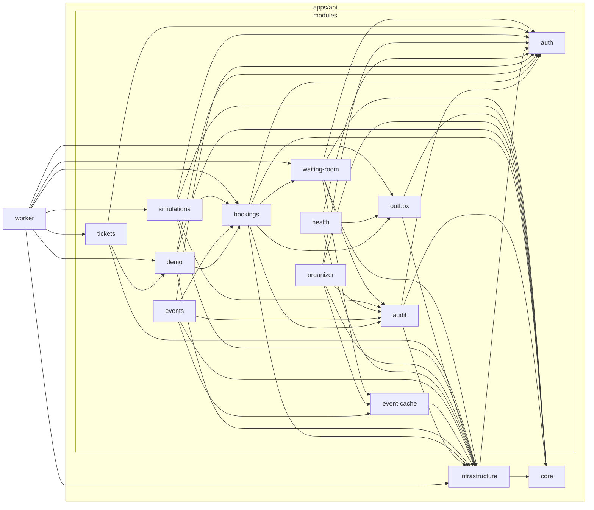

# Architecture

The system is a modular monolith plus a worker
([ADR 0001](adr/0001-modular-monolith-and-worker.md)). The runtime picture (browser, Caddy, the API
replicas, PostgreSQL, Redis, the queue) is the diagram in the [README](../README.md#architecture).
This page shows the code: who may depend on whom.

## Layers

- `packages/shared` holds the contracts (Zod schemas, inferred types, dictionaries) and nothing else.
  Every app depends on it; it depends on no app.
- Each API module has a `domain/` folder of pure logic that defines the ports; controllers, services
  and adapters sit around it. `infrastructure` holds the adapters shared by modules (database,
  cache, queue client, metrics, tracing), `core` the logic several modules share.
- A module imports another module only through its `index.ts`. The worker reuses the API's modules
  the same way; the API never imports the worker.

`pnpm depcruise` enforces this and fails on a forbidden edge or a cycle. The rules are in
[AGENTS.md](../AGENTS.md#1-layers-enforced-by-pnpm-depcruise-and-eslint).

## Module graph

An arrow means "imports". Specs, test support and the packages every module uses
(`packages/shared`, the config module) are left out. The graph is generated from the code by
`pnpm docs:generate`; `pnpm check` fails when it is stale. The full file-level graph for a
Mermaid viewer is `pnpm depcruise:graph`.

<!-- prettier-ignore-start -->
<!-- generated:modules -->

<!-- /generated -->
<!-- prettier-ignore-end -->
