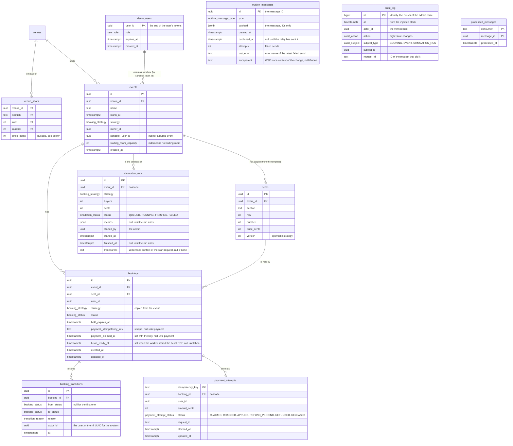
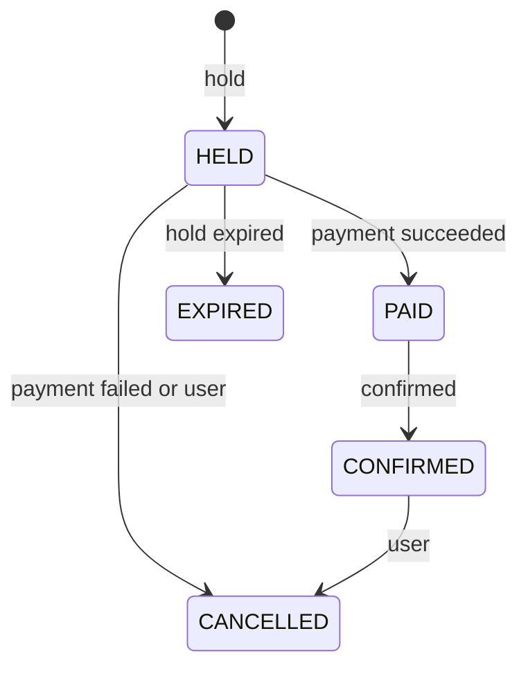

# Data model

PostgreSQL schema of the booking core. The Drizzle schema is
`apps/api/src/infrastructure/database/schema.ts`; migrations in `apps/api/drizzle` are generated by
drizzle-kit (`pnpm db:generate`) and applied by `pnpm db:migrate`, which also runs the idempotent
seed (two venues, five public events: one per booking strategy and one with a waiting room).

## Entities

`payment_attempts` tracks every charge attempt across the three-step payment flow (claim, provider
charge, apply/refund) so the worker's reconciliation job (every 30 s) can settle crashed charges
(`CHARGED` while the booking is still `HELD` -> `CONFIRMED` + `BOOKING_CONFIRMED` outbox message),
retry failed late-charge refunds (`REFUND_PENDING` -> `REFUNDED` + `PAYMENT_REFUNDED` audit row)
and probe stale `CLAIMED` rows against the provider's lookup when supported.

`demo_users` lists the temporary Keycloak users of the demo login. It has no foreign key: `user_id`
is the Keycloak user ID, which `events.sandbox_user_id`, `events.owner_id` and `bookings.user_id`
also carry. The cleanup job reads `expires_at` (indexed) and, per expired user, deletes the
Keycloak user, then the user's bookings, the sandbox events (their seats and transitions cascade)
and the row, in one transaction.

`simulation_runs` holds one rush of the simulator. The run belongs to its own sandbox event (owned
by the admin who started it, so it never shows in the public list); deleting the event deletes the
run. `metrics` is a JSON document of the shape `SimulationMetricsSchema`, null until the run ends.
`traceparent` is the trace context of the request that started the run (null outside a trace and on
runs older than the column); the worker continues it, so the run's spans join that trace and the
API can link the run to it.
`simulation_runs(status, started_at)` serves the cap query, which counts the runs that are still
active and started within the timeout.

`outbox_messages` holds the queue messages of state changes. A row is written in the transaction of
the change it announces, so it exists if and only if the change committed; it also stores the
`traceparent` of the span that wrote it (null outside a trace, and on rows older than the column).
The relay continues that trace while it sends and hands the send span's context to the queue as a
message attribute, so a booking is one trace through the queue. The relay in the worker
selects unpublished rows oldest first with `FOR UPDATE SKIP LOCKED`, sends them and sets
`published_at`; a failed send raises `attempts` and stores the error name in `last_error`. The row
ID is the message ID. `outbox_messages(created_at)` is a partial index on the unpublished rows, so
it serves the relay and the readiness check however many rows are published. A unique partial index
on `payload->>'bookingId'` for `BOOKING_CONFIRMED` rows makes one confirmation message per booking a
database guarantee. The worker's retention job deletes published rows seven days after they were
published (1000 rows a minute at most), for as long as that keeps the table small enough to scan;
unpublished rows stay. `processed_messages(consumer, message_id)` is the
consumers' idempotency record: the primary key turns a second delivery of a message ID into a
no-op for that consumer. The same job deletes a record seven days after `processed_at` (the same
batch); that is longer than the queue's message retention (the SQS default of 4 days), so no
message can arrive after its record is gone. The deletes use no index on their time columns:
each tick scans the table. Neither table has a foreign key: the payload holds IDs of rows that may
be deleted later (a demo user's cleanup), and a message must survive that.

`audit_log` holds one row per audited state change (hold, payment, refund of a late charge, cancellation, event
creation, strategy switch, waiting-room change, simulation start): who (`actor_id`), what (`action`,
`subject_type`, `subject_id`) and the request that did it (`request_id`), IDs only. `request_id` is the caller's `x-request-id` only
when it matches `^[A-Za-z0-9._-]{1,128}$`, otherwise a generated UUID, so no free text (an email
address) reaches the table or the logs. It is
append-only: `AuditService.record` is the only writer, it inserts on the transaction of the change
(so a rolled-back change leaves no row), `app_runtime` has no `UPDATE` or `DELETE` privilege on the
table, and migration `0016` installs a `BEFORE UPDATE OR DELETE` trigger (`audit_log_append_only`)
that rejects mutations even from the table owner. `at` comes from
the injected clock. The table has no foreign key: a row must outlive a deleted demo user or event.
`audit_log(actor_id, id)` and `audit_log(action, id)` serve the filtered pages of the admin route,
which pages newest first by `id`. There is no retention yet (backlog).

Seats are copied from the venue template when an event is created (one `INSERT ... SELECT` in the
same transaction as the event), so a later change of the template does not move seats of events
that already sell. The template carries the price per seat (`venue_seats.price_cents`). The column is
nullable because it was added in the expand step of a backward-compatible change: the idempotent
seed, which runs on every deploy, fills it for the rows that already exist. A template seat without
a price makes the creation fail as a whole, since `seats.price_cents` is not null. Making the column
`not null` is the later contract step. Foreign keys from seats, bookings and
transitions up to the event cascade on delete. The status of a seat (available, held, sold) is
derived from its bookings and never stored.

`events.waiting_room_capacity` is the waiting room switch: null means the event has none, a number
is how many customers may hold seats at once. A check constraint keeps the number positive; the
upper bound (`MAX_ADMISSION_CAPACITY`) lives in the request schema. The column was added in the
expand step, existing events keep null.

## Connections

The API and the worker reach PostgreSQL through PgBouncer in transaction mode
([ADR 0005](adr/0005-pgbouncer-transaction-mode.md)). Code that touches the database keeps every
lock and setting inside one transaction: `pg_advisory_xact_lock`, `FOR UPDATE` and
`set_config(..., true)` are fine, session-level locks, `LISTEN` and `SET` without `LOCAL` are not.
`pnpm test:db:pooled` is the guard. Migrations run on a direct connection.

The apps connect as `app_runtime` (`DATABASE_URL`), which has table rights through grants and owns
nothing. The migration job connects as the owner `app` (`MIGRATION_DATABASE_URL`), creates the
runtime role with the password of `DATABASE_URL` and applies the migrations.

## Row-level security

`bookings` and `booking_transitions` have row-level security enabled and forced
([ADR 0009](adr/0009-row-level-security.md)). Their policies restrict rows only while the
transaction set `app.scope = 'user'`: then a row is visible and writable only if its booking has
`user_id = app.user_id`, and a missing `app.user_id` sees nothing. Any other scope restricts
nothing, so the worker and the cross-user reads are unchanged. `withOwner` (in
`infrastructure/database/rls.ts`) sets both settings for one statement block with
`set_config(..., true)` and sets the scope back to `system` afterwards. The booking list and the
transitions that pay and cancel store use it; the policy is a second layer, the `user_id` filter of
the queries stays.

## Booking state machine

Every change of `bookings.status` goes through the state machine in the bookings domain and writes
a row to `booking_transitions` in the same transaction.

## Why `strategy` sits on the booking

`bookings_active_seat_uidx` is a partial unique index on `bookings(seat_id)` for the active
statuses (HELD, PAID, CONFIRMED). It is the last line of defense against a double booking:
whatever the application code does, the database refuses a second active booking of a seat.

The `naive` strategy exists to show what happens without protection, so it must be allowed to
double book. An index cannot look at another table, so the strategy is copied from the event onto
the booking and the index excludes `NAIVE`. A booking keeps the strategy it was made under even if
an admin later switches the event.

`seats` is unique per `(event_id, section, row, number)`, and `bookings(seat_id)` is indexed for the
seat status lookups. `bookings(status, hold_expires_at)` serves the expiry job, which looks for HELD bookings whose hold
has passed. `bookings(event_id, status)` serves the per-event counts: the organizer's sold and held
seats and the double-booking count.
