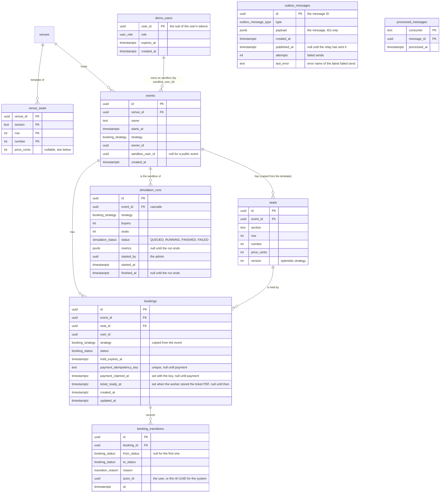
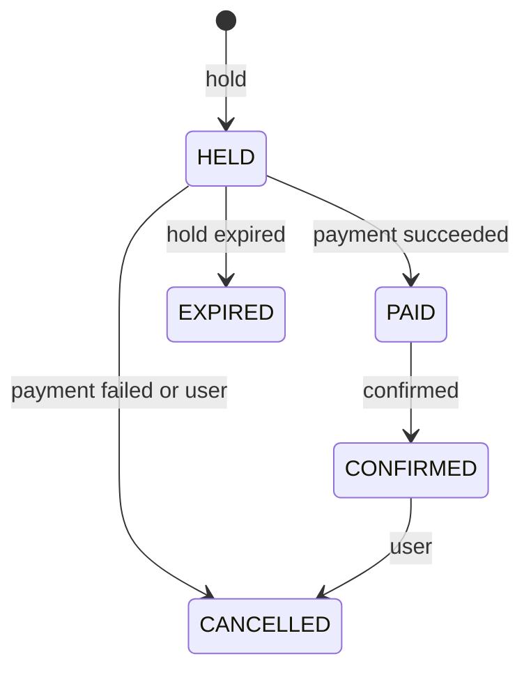

# Data model

PostgreSQL schema of the booking core. The Drizzle schema is
`apps/api/src/infrastructure/database/schema.ts`; migrations in `apps/api/drizzle` are generated by
drizzle-kit (`pnpm db:generate`) and applied by `pnpm db:migrate`, which also runs the idempotent
seed (two venues, four public events, one per booking strategy).

## Entities

`demo_users` lists the temporary Keycloak users of the demo login. It has no foreign key: `user_id`
is the Keycloak user ID, which `events.sandbox_user_id`, `events.owner_id` and `bookings.user_id`
also carry. The cleanup job reads `expires_at` (indexed) and, per expired user, deletes the
Keycloak user, then the user's bookings, the sandbox events (their seats and transitions cascade)
and the row, in one transaction.

`simulation_runs` holds one rush of the simulator. The run belongs to its own sandbox event (owned
by the admin who started it, so it never shows in the public list); deleting the event deletes the
run. `metrics` is a JSON document of the shape `SimulationMetricsSchema`, null until the run ends.
`simulation_runs(status, started_at)` serves the cap query, which counts the runs that are still
active and started within the timeout.

`outbox_messages` holds the queue messages of state changes. A row is written in the transaction of
the change it announces, so it exists if and only if the change committed. The relay in the worker
selects unpublished rows oldest first with `FOR UPDATE SKIP LOCKED`, sends them and sets
`published_at`; a failed send raises `attempts` and stores the error name in `last_error`. The row
ID is the message ID. `outbox_messages(created_at)` is a partial index on the unpublished rows, so
it serves the relay and the readiness check however many rows are published. Published rows are
kept; deleting old ones is a backlog item. `processed_messages(consumer, message_id)` is the
consumers' idempotency record: the primary key turns a second delivery of a message ID into a
no-op for that consumer. Neither table has a foreign key: the payload holds IDs of rows that may
be deleted later (a demo user's cleanup), and a message must survive that.

Seats are copied from the venue template when an event is created (one `INSERT ... SELECT` in the
same transaction as the event), so a later change of the template does not move seats of events
that already sell. The template carries the price per seat (`venue_seats.price_cents`). The column is
nullable because it was added in the expand step of a backward-compatible change: the idempotent
seed, which runs on every deploy, fills it for the rows that already exist. A template seat without
a price makes the creation fail as a whole, since `seats.price_cents` is not null. Making the column
`not null` is the later contract step. Foreign keys from seats, bookings and
transitions up to the event cascade on delete. The status of a seat (available, held, sold) is
derived from its bookings and never stored.

## Booking state machine

Every change of `bookings.status` goes through the state machine in the bookings domain and writes
a row to `booking_transitions` in the same transaction.

## Why `strategy` sits on the booking

`bookings_active_seat_uidx` is a partial unique index on `bookings(seat_id)` for the active
statuses (HELD, PAID, CONFIRMED). It is the last line of defense against a double booking:
whatever the application code does, the database refuses a second active booking of a seat.

The `naive` strategy exists to show what happens without protection, so it must be allowed to
double book. An index cannot look at another table, so the strategy is copied from the event onto
the booking and the index excludes `NAIVE`. A booking keeps the strategy it was made under even if
an admin later switches the event.

`seats` is unique per `(event_id, section, row, number)`, and `bookings(seat_id)` is indexed for the
seat status lookups. `bookings(status, hold_expires_at)` serves the expiry job, which looks for HELD bookings whose hold
has passed. `bookings(event_id, status)` serves the per-event counts: the organizer's sold and held
seats and the double-booking count.
