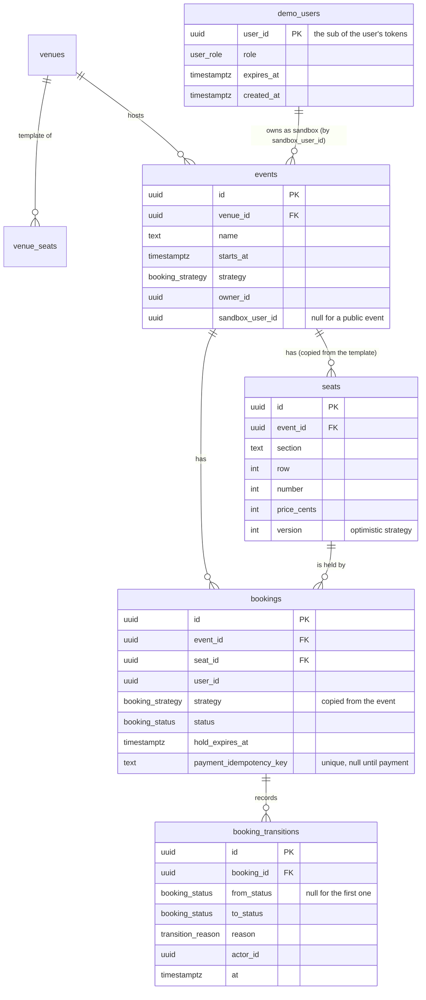
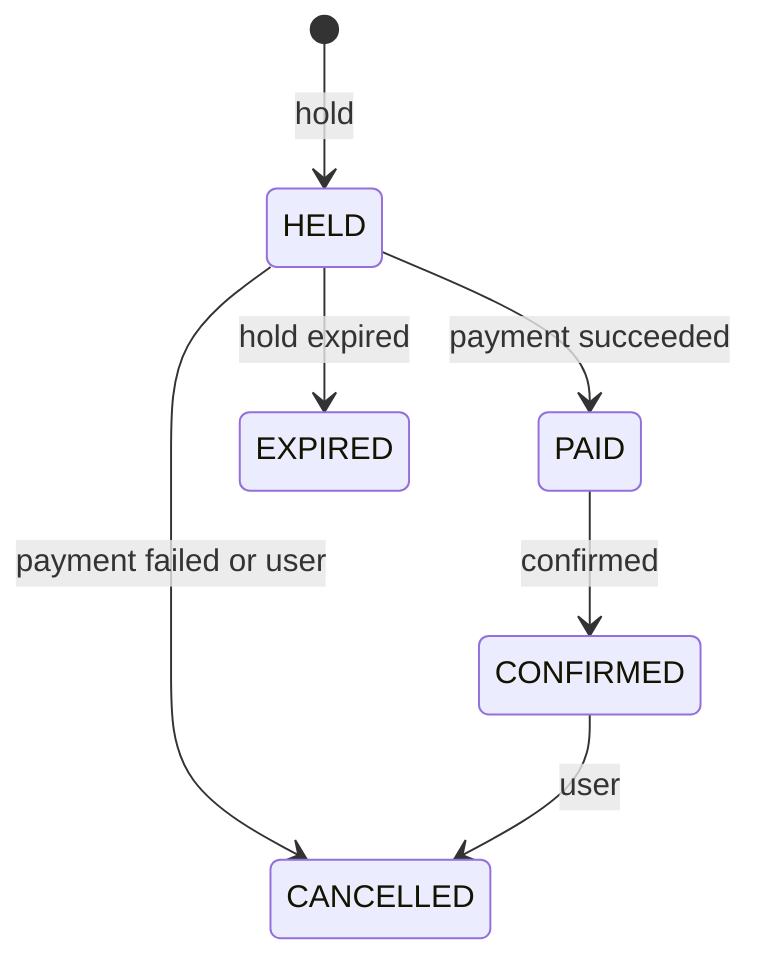

# Data model

PostgreSQL schema of the booking core. The Drizzle schema is
`apps/api/src/infrastructure/database/schema.ts`; migrations in `apps/api/drizzle` are generated by
drizzle-kit (`pnpm db:generate`) and applied by `pnpm db:migrate`, which also runs the idempotent
seed (two venues, four public events, one per booking strategy).

## Entities

`demo_users` lists the temporary Keycloak users of the demo login. It has no foreign key: `user_id`
is the Keycloak user ID, which `events.sandbox_user_id`, `events.owner_id` and `bookings.user_id`
also carry. The cleanup job reads `expires_at` (indexed) and, per expired user, deletes the
Keycloak user, then the user's bookings, the sandbox events (their seats and transitions cascade)
and the row, in one transaction.

Seats are copied from the venue template when an event is created, so a later change of the
template does not move seats of events that already sell. Foreign keys from seats, bookings and
transitions up to the event cascade on delete. The status of a seat (available, held, sold) is
derived from its bookings and never stored.

## Booking state machine

Every change of `bookings.status` goes through the state machine in the bookings domain and writes
a row to `booking_transitions` in the same transaction.

## Why `strategy` sits on the booking

`bookings_active_seat_uidx` is a partial unique index on `bookings(seat_id)` for the active
statuses (HELD, PAID, CONFIRMED). It is the last line of defense against a double booking:
whatever the application code does, the database refuses a second active booking of a seat.

The `naive` strategy exists to show what happens without protection, so it must be allowed to
double book. An index cannot look at another table, so the strategy is copied from the event onto
the booking and the index excludes `NAIVE`. A booking keeps the strategy it was made under even if
an admin later switches the event.

`bookings(status, hold_expires_at)` serves the expiry job, which looks for HELD bookings whose hold
has passed.
